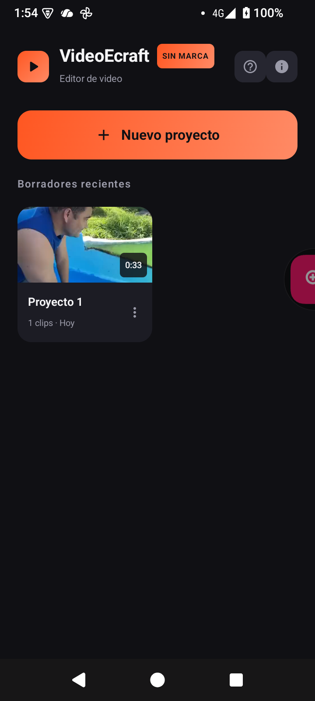
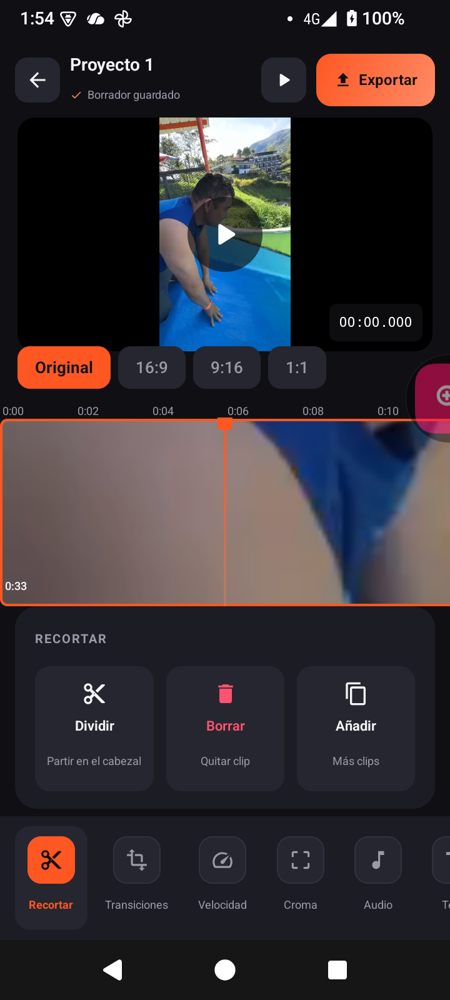
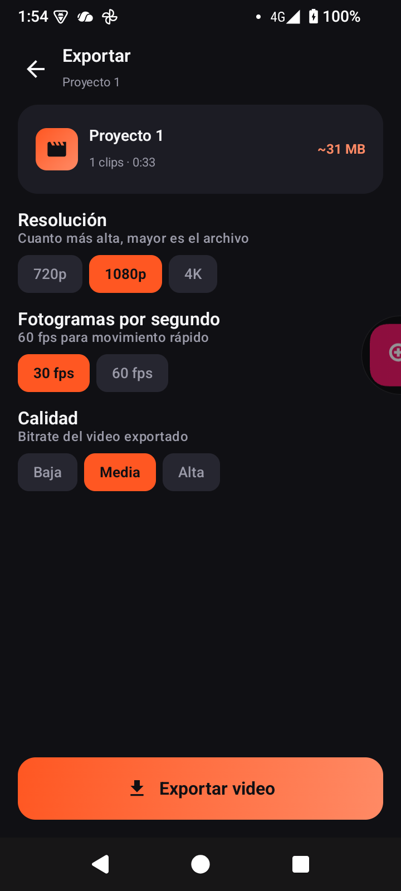
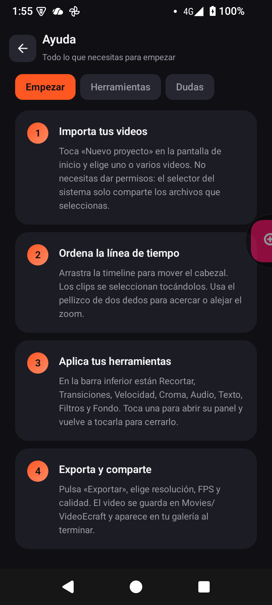
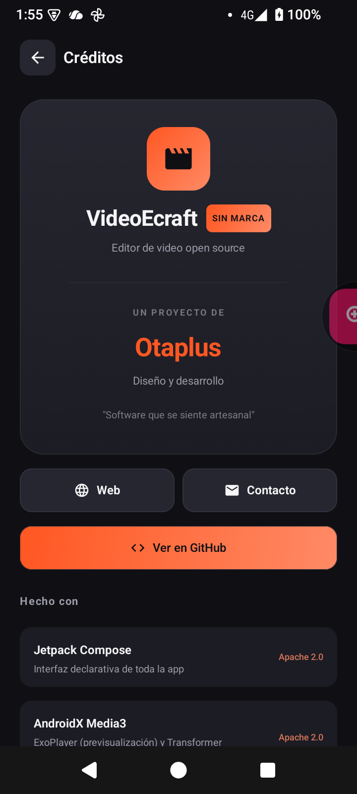

<div align="center">

# 🎬 VideoEcraft

**Editor de video móvil, ligero y sin marcas de agua.**

[](https://kotlinlang.org)
[](https://developer.android.com/jetpack/compose)
[](https://developer.android.com/media/media3)
[](https://developer.android.com)
[](LICENSE)
[]()

Un editor de video para Android inspirado en los grandes editores móviles, pero **open source**, **sin marca de agua**, **sin límite de duración** y con **todo el procesamiento en tu dispositivo**.

[Características](#-características) · [Capturas](#-capturas) · [Stack](#-stack-tecnológico) · [Compilar](#-cómo-compilar) · [Arquitectura](#-arquitectura)

</div>

---

## ✨ Características

### Editor completo
- **Timeline multicapa** — pistas de video, superposiciones, texto y audio con cabezal fijo, zoom con pellizco y scroll fluido
- **Recortar y dividir** — corta bordes o parte un clip en el punto exacto del cabezal
- **Transiciones** — fundido a negro, disolución, deslizamiento lateral y zoom, con easing
- **Velocidad 0.2x – 4x** — con **corrección de tono** (`SonicAudioProcessor`), la voz no suena a "chipmunk"
- **Chroma Key** — shader GLSL propio con detección en croma YUV, alfa continuo y **spill suppression**
- **Filtros y ajustes** — 7 presets (Cine, Noir, Vívido, Retro…) + brillo, contraste, saturación y calidez
- **Audio** — música local en bucle, mezclador de volumen música/original y mute
- **Texto** — capas arrastrables, redimensionables y rotables con color y tamaño
- **Lienzo** — 16:9, 9:16 y 1:1 con fondo de desenfoque del propio video o color sólido

### Exportación
- Resolución **720p / 1080p / 4K**
- **30 / 60 FPS** y 3 niveles de bitrate
- Progreso circular en tiempo real
- Exportación en **foreground service** — sigue aunque bloquees el teléfono
- Guardado en `Movies/VideoEcraft` vía MediaStore

### Privacidad por diseño
- **Cero permisos de almacenamiento** para importar video (Photo Picker del sistema)
- **Cero red** — todo el procesamiento es local, vía GPU y codificador del dispositivo
- **Sin marca de agua**, sin cuentas, sin telemetría

---

## 📱 Capturas

<table>
  <tr>
    <td align="center" width="33%">
      <br>
      <sub><b>Inicio</b> · proyectos y borradores</sub>
    </td>
    <td align="center" width="33%">
      <br>
      <sub><b>Editor</b> · visor, timeline y herramientas</sub>
    </td>
    <td align="center" width="33%">
      <br>
      <sub><b>Exportación</b> · resolución, FPS y calidad</sub>
    </td>
  </tr>
  <tr>
    <td align="center" width="33%">
      <br>
      <sub><b>Ayuda</b> · guía, herramientas y dudas</sub>
    </td>
    <td align="center" width="33%">
      <br>
      <sub><b>Créditos</b> · Otaplus y stack</sub>
    </td>
    <td width="33%"></td>
  </tr>
</table>

---

## 🛠 Stack tecnológico

| Capa | Tecnología | Para qué |
|---|---|---|
| **Lenguaje** | Kotlin 2.4.21 | Coroutines, Flow, value classes |
| **UI** | Jetpack Compose (BOM 2026.02) | Toda la interfaz, Material 3 + tema propio |
| **Multimedia** | AndroidX Media3 1.11.1 | ExoPlayer (preview) + Transformer (export) |
| **Efectos** | Media3 Effect (`GlEffect`) | Chroma key, filtros, transiciones en GPU |
| **Persistencia** | Room 2.8.5 | Proyectos y borradores, con esquema exportado |
| **Imágenes** | Coil 3.6.3 + coil-video | Miniaturas de video en la timeline |
| **Navegación** | Navigation Compose 2.10.2 | Home → Editor → Exportación |
| **Build** | AGP 9.5.3 · KSP 2.3.14 | — |

---

## 🚀 Cómo compilar

### Requisitos
| Herramienta | Versión |
|---|---|
| Android Studio | Meerkat (2025.1) o superior |
| JDK | **17** (obligatorio: AGP 9 + Media3 Transformer) |
| Android SDK | Compile SDK **37** |
| Dispositivo | Android **7.0 (API 24)** o superior |

### Pasos

```bash
# 1. Clona el repositorio
git clone https://github.com/otaplus/videoecraft.git
cd videoecraft

# 2. Compila el APK de debug
./gradlew :app:assembleDebug

# 3. Instálalo en un dispositivo o emulador conectado
./gradlew :app:installDebug
```

En Windows:

```powershell
.\gradlew.bat :app:assembleDebug
```

### Ejecutar los tests

```bash
./gradlew :app:testDebugUnitTest
```

> La suite actual (**46 tests**) cubre la lógica pura del motor — composición
> de matrices de color, duraciones con velocidad, dimensiones de lienzo,
> round-trip del códec — y el ciclo de vida de los medios importados, con
> regresiones de los bugs encontrados en dispositivo.

---

## 🚀 Publicar una release

El proyecto incluye automatización completa: **empuja un tag y GitHub compila,
firma y publica el APK** en la sección Releases.

### 1. Genera tu keystore (una sola vez)

Windows:

```powershell
.\scripts\setup-keystore.ps1
```

El script localiza el `keytool` del JDK, crea `keys/videoecraft-release.jks` y
te muestra los 4 valores a configurar.

> [!CAUTION]
> **Guarda el keystore en un lugar seguro y fuera del repositorio.** Es la
> identidad de firma de la app: si lo pierdes no podrás publicar
> actualizaciones sobre las instalaciones existentes. `keys/` ya está en
> `.gitignore`.

### 2. Configura los GitHub Secrets

En **Settings → Secrets and variables → Actions**, crea:

| Secret | Valor |
|---|---|
| `VIDEOECRAFT_KEYSTORE_BASE64` | el contenido de `keys/keystore-base64.txt` |
| `VIDEOECRAFT_KEYSTORE_PASSWORD` | contraseña del keystore |
| `VIDEOECRAFT_KEY_ALIAS` | `videoecraft` |
| `VIDEOECRAFT_KEY_PASSWORD` | contraseña de la clave (suele ser la misma) |

Sin estos secrets el workflow sigue funcionando, pero produce un **APK sin
firmar** (útil para verificar que el pipeline no se rompe).

### 3. Publica

```bash
git tag v1.0.0
git push origin v1.0.0
```

Eso dispara `.github/workflows/release.yml`, que:

1. Valida el formato del tag (`vX.Y.Z`).
2. Deriva `versionName` del tag y un `versionCode` monotónico (`1.2.3` → `10203`).
3. Corre los tests — **si fallan, no hay release**.
4. Compila el APK de release con R8 y lo firma con tu keystore.
5. Crea la Release en GitHub con el APK adjunto y nota de instalación.

Para re-publicar una versión existente, usa **Actions → Release → Run
workflow** e introduce el tag.

### Build de release local

```bash
./gradlew :app:assembleRelease -PversionName=1.0.0 -PversionCode=10000
```

Sin las variables de entorno de firma, el APK sale sin firmar — lo cual es
lo esperado en un fork o en un PR.

---

## 🏗 Arquitectura

Clean MVVM con **inyección de dependencias manual** (sin Hilt: el grafo tiene ~10 nodos y no justifica un plugin de compilación extra).

```
UI (Compose) ──► ViewModel (StateFlow) ──► Repository ──► Room
     │                  │
     │                  └──► EditSpec  (modelo puro, testeable en JVM)
     │                            │
     └────────────────────────────┴──► VideoProcessor ──► Transformer ──► MP4
                                              │
                                              └──► GlEffect (shaders GPU)
```

### Decisiones de diseño

**`EditSpec` es el contrato.** Es un modelo de datos puro sin tipos de Media3 en su superficie pública, así que el 100 % de la lógica de edición es testeable en la JVM sin emulador. El motor lo traduce a `Composition`; la UI nunca toca Media3.

**Transiciones dentro del clip.** Media3 1.11 no soporta crossfade entre secuencias de una `Composition`. La solución es aplicar la transición *dentro* del `EditedMediaItem` del clip entrante con `MatrixTransformation` dependiente del tiempo — visualmente equivalente y totalmente soportado.

**Shaders propios sobre `BaseGlShaderProgram`.** El chroma key, la matriz de color y el blur se implementan como `GlShaderProgram`. Las dos pasadas 1D del blur son O(2N) frente a O(N²) de un blur 2D en un solo pase.

**Autoguardado con debounce.** Cada cambio pasa por el ViewModel y agenda un guardado a 800 ms. Arrastrar un slider no genera decenas de escrituras a Room.

### Estructura del proyecto

```
app/src/main/java/com/example/videoecraft/
├── VideoEcraftApp.kt           Application + Coil + AppContainer
├── MainActivity.kt             Única Activity, host de Compose
├── engine/                     ── MOTOR MULTIMEDIA ──
│   ├── VideoProcessor.kt       EditSpec → Composition → Transformer
│   ├── SpeedProvider.kt        Velocidad con pitch correction
│   ├── MediaStoreSaver.kt      Publicación en Movies/VideoEcraft
│   ├── model/EditSpec.kt       Modelo puro de la edición
│   └── effects/                Shaders GLSL y GlEffect
│       ├── Shaders.kt
│       ├── ChromaKeyEffect.kt
│       ├── ColorFilterEffect.kt
│       └── TransitionEffects.kt
├── data/                       ── PERSISTENCIA ──
│   ├── db/                     Room: entidades, DAO, database
│   └── repository/
├── ui/                         ── INTERFAZ ──
│   ├── home/                   Cuadrícula de proyectos
│   ├── editor/                 Visor, timeline, herramientas
│   ├── export/                 Configuración y progreso
│   ├── help/                   Guía y preguntas frecuentes
│   ├── credits/                Créditos del proyecto
│   ├── navigation/             Grafo Compose
│   └── theme/                  Paleta "Craft"
└── export/                     Foreground service de exportación
```

---

## 🎨 Identidad visual

Paleta **"Craft"**: modo oscuro profundo con acentos en degradado naranja neón → coral.

| Rol | Color |
|---|---|
| Fondo | `#101014` |
| Superficie | `#1C1C24` |
| Superficie elevada | `#262630` |
| Acento inicio | `#FF5722` |
| Acento fin | `#FF8A65` |
| Texto primario | `#F5F5F7` |

El icono adaptable es una capa vectorial con un cubo isométrico "craft", un triángulo de play y una cinta de cine, con variante monochrome para los iconos temáticos de Android 13+.

---

## 🤝 Contribuir

Las contribuciones son bienvenidas. Lee [CONTRIBUTING.md](CONTRIBUTING.md) antes de abrir un PR.

> ¿Vas a publicar tu propio fork? Sigue [PUBLISHING.md](PUBLISHING.md):
> guía completa de Git, keystore de firma y publicación automática de
> releases con el APK adjunto.

```bash
# 1. Haz fork y crea tu rama
git checkout -b feature/mi-mejora

# 2. Sigue el estilo del proyecto y añade tests
./gradlew :app:testDebugUnitTest

# 3. Abre un Pull Request describiendo el cambio
```

---

## 📄 Licencia

Distribuido bajo **Apache License 2.0**. Consulta [LICENSE](LICENSE) para más detalles.

```
Copyright 2026 Otaplus

Licensed under the Apache License, Version 2.0 (the "License");
you may not use this file except in compliance with the License.
You may obtain a copy of the License at

    http://www.apache.org/licenses/LICENSE-2.0
```

---

<div align="center">

**Hecho con cuidado por [Otaplus](https://otaplus.dev)**

</div>
